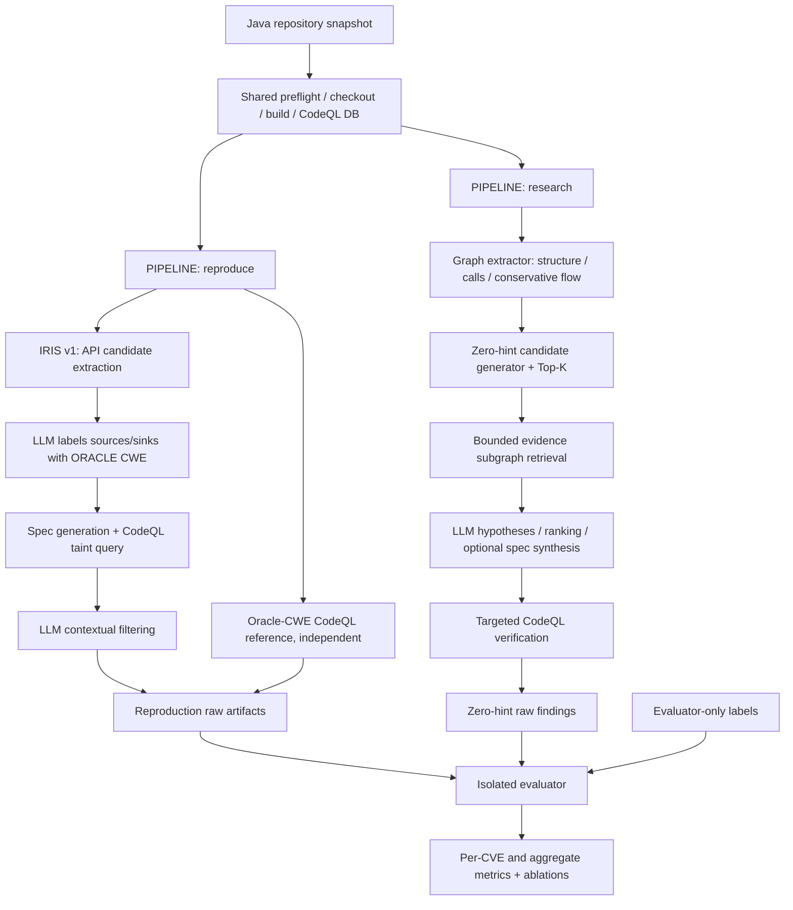

# MAXVERA — KẾ HOẠCH TÁI CẤU TRÚC VÀ TRIỂN KHAI PIPELINE NGHIÊN CỨU

> **Version:** 2.0 — 20/10/2026  
> **Status:** Implementation specification cho coding agent; **chưa phải báo cáo code đã sửa/chạy**.  
> **Supersedes:** `ke_hoach_trien_khai_zero_hint_repository_vulnerability_research.md` v1.4 (01/09/2026).  
> **Project:** [MaxVera](https://github.com/khanhtran0111/MaxVera).  
> **Định hướng:** *Graph-Grounded Vulnerability Candidate Discovery for Zero-Hint Repository-Level Static Analysis*.  
> **Scope v2:** Java, CodeQL, CWE-Bench-Java 120-CVE subset từ IRIS v1, `openai/gpt-oss-20b` qua OpenRouter.  
> **Cách vận hành:** **pipeline-first**, không tổ chức/chạy theo `Phase 0/1/2/…`, không có `phaseN_*.py` làm public entrypoint.

## 0. Chỉ thị bắt buộc dành cho coding agent

**Nhiệm vụ:** Refactor **repository hiện có**, không khởi tạo một project mới, thành hai pipeline chính chạy end-to-end và một evaluator độc lập:

1. **`reproduce`** — tái lập IRIS v1 với GPT-OSS-20B, đồng thời đo CodeQL baseline dưới protocol rõ ràng. Đây là *oracle-CWE / model-substituted reproduction*.
2. **`research`** — thử nghiệm phương pháp mới **zero-hint**: phân tích repository, sinh ứng viên lỗ hổng dựa trên graph, xếp hạng Top-K, suy luận từ evidence bằng LLM và kiểm chứng tĩnh có kiểm soát. Không dùng CWE/CVE thật làm đầu vào của analyzer.
3. **`evaluate` / `compare`** — chấm điểm và tổng hợp kết quả bằng ground truth chỉ ở evaluator, không nằm trong analyzer.

**Nguyên tắc thực hiện:**

- Đầu tiên **audit source tree và các artifact** trong MaxVera đang checkout, xác định phần nào đã chạy được, phần nào chỉ mới được đề xuất; lập `docs/migration_inventory.md` và `docs/migration_decisions.md`. **Không được giả định cấu trúc repository khớp tài liệu này.**
- Giữ nguyên lịch sử và artifact reproduction cũ. Không xóa, không sửa kết quả Phase 4 hay đổi nhãn thành kết quả pipeline mới. Đọc kết quả cũ để lập regression test và baseline đối chiếu.
- **Refactor/reuse trước, rewrite sau.** Giữ code/queries/prompts của IRIS ở mức fidelity cao, tạo adapters và interfaces mới xung quanh code hiện hữu. Nếu phải sửa semantics của IRIS, lưu diff và đánh dấu `deviation`.
- Chuyển mọi script `phaseN*` / `bN*` thành **internal modules hoặc deprecated wrappers**, không dùng làm CLI chính. Các module nội bộ vẫn có stage/checkpoint vì cần debug; **người dùng chỉ chạy pipeline**.
- Không tự claim đã chạy full, đạt metric hay tái hiện đúng paper nếu chưa kiểm tra bằng code và artifact. Mọi tiêu chí dưới đây là **yêu cầu triển khai/kiểm định**, không phải kết quả đã đạt.
- Sau mỗi thay đổi có thể chạy unit/integration test. **Không tự gọi full OpenRouter/CodeQL expensive run** nếu chưa có lệnh/yêu cầu rõ ràng từ người dùng; `--dry-run`/smoke là mặc định cho kiểm tra phát triển.
- Nguyên tắc nghiên cứu quan trọng nhất: **zero-hint chỉ được truy cập `analysis_input`; mọi ground truth, patched locations, CVE/CWE oracle chỉ được đọc trong `evaluator_only` và pipeline `reproduce` khi đúng chế độ oracle.**

### 0.1. Đầu ra coding agent phải bàn giao

- Mã nguồn đã refactor hoạt động trong repo hiện tại.
- CLI thống nhất; config YAML; schema dữ liệu; tests; README/runbook cho hai pipeline.
- `docs/migration_inventory.md` ghi đầy đủ mapping file cũ → module mới; ghi các module chưa implement.
- `docs/reproduction_protocol.md`, `docs/research_protocol.md`, `docs/evaluation_protocol.md`.
- Lệnh smoke/dry-run đã thực sự chạy và báo cáo ngắn gọn có exit code; không cần khẳng định full benchmark khi chưa được chạy.
- Một file `docs/IMPLEMENTATION_STATUS.md` theo từng capability với trạng thái `IMPLEMENTED / PARTIAL / NOT_IMPLEMENTED / BLOCKED`, có link tới code/test thực tế.

---

## 1. Mục tiêu khoa học và quyết định phạm vi

### 1.1. Hai câu hỏi độc lập

**Reproduction:** Khi giữ cấu trúc phân tích của IRIS v1 nhưng thay LLM bằng GPT-OSS-20B qua OpenRouter, pipeline phát hiện được bao nhiêu CVE trên subset 120 trường hợp? Hệ thống có đảm bảo full accounting, stage-level traceability và evaluator tương thích paper hay không?

**Research:** Khi chỉ nhận source repository Java (*zero-hint*), phương pháp **graph-grounded candidate discovery** có đưa vulnerability thật vào **Top-K candidate** tốt hơn static alerts/text-only retrieval, và có giúp tăng **final verified detection** với chi phí hợp lý hay không?

**Không được suy luận:** Kết quả mới cao/thấp hơn reproduction do graph tốt hơn/kém hơn nếu một bên có oracle CWE. Reproduction oracle là **reference**, không phải baseline cùng thông tin với zero-hint.

### 1.2. Nghiên cứu ưu tiên (core contribution)

**Core:** `Repository → Program/Security Evidence Graph → Graph-guided Candidate Discovery → Top-K → Evidence-grounded LLM Reasoning → Targeted Static Verification → Ranked Findings`.

Ưu tiên kiểm định một cải tiến **đo lường được về candidate discovery** thay vì triển khai ngay multi-agent, KG phức tạp, calibration hay agent orchestration nhiều tầng. Tầng Security KG/Evidence Graph/USEG có thể phát triển theo các variant, nhưng **không được che khuất câu hỏi nghiên cứu chính**.

**Novelty giả thuyết, chưa khẳng định:** truy xuất đường liên file và cấu trúc chương trình để **tạo/định vị vulnerability candidates chưa được query CodeQL mặc định xác nhận**, cung cấp bằng chứng nguồn gốc rõ ràng và giảm nhu cầu gửi raw repository cho LLM. Nếu chỉ lấy CodeQL alerts sẵn có rồi gắn graph để xếp hạng, đó chủ yếu là alert triage, **chưa chứng minh được new candidate discovery**.

### 1.3. Research questions phiên bản v2

| ID | Câu hỏi | Đối chứng quan trọng |
|---|---|---|
| RQ1 | Graph-guided generation/ranking tăng candidate-level/CVE-level Recall@K so với default static-alert candidates? | `graph_only` vs `static_only`; so với `text_only` như end-to-end setting, không phải causal isolation |
| RQ2 | LLM reasoning dựa trên bounded evidence graph tăng chất lượng xếp hạng/triage? | `graph_llm` vs `graph_only` trên **cùng candidate pool** |
| RQ3 | Targeted static verification tăng bằng chứng có thể kiểm chứng mà không làm tụt recall quá mức? | `graph_llm_verify` vs `graph_llm`; báo cả pre/post verification |
| RQ4 | Graph/context pruning làm thay đổi Recall@K, tokens, calls, wall time thế nào? | `full_graph_context` vs `minimal_subgraph`, budget matched |
| RQ5 (mở rộng) | Security KG và evidence feedback có đóng góp thêm, ngoài program graph? | `program_graph` vs `program+security_kg` vs USEG; chỉ sau khi RQ1–RQ3 chạy ổn |

### 1.4. Điều gì **không** thuộc v2 core

- Không cố generalize mọi ngôn ngữ trong vòng triển khai đầu tiên.
- Không tuyên bố `CWE-Bench-Java 120` chứng minh precision/FDR tuyệt đối trên toàn bộ repo, vì các nhãn chỉ đầy đủ cho CVE đã biết.
- Không ép buộc GNN, vector database, Neo4j, multi-agent hoặc local model trong bản đầu. Graph có thể nằm trong Parquet/SQLite + adjacency indexes; chọn theo kết quả benchmark.
- Không yêu cầu tái hiện **con số GPT-4** của paper khi đang dùng GPT-OSS-20B.

---

## 2. Flow tổng thể — 2 pipeline, chung hạ tầng



**Lưu ý:** `reproduce` giữ oracle CWE theo IRIS; `research` cấm oracle CWE. `Shared preflight` và database cache có thể tái sử dụng nếu **chỉ phụ thuộc vào source và tool version**, tuyệt đối không tái sử dụng cache đã chứa nhãn/patch/hint hay query oracle.

### 2.1. Hợp đồng vận hành (public CLI)

Thiết kế một giao diện CLI nhất quán. Các lệnh dưới đây là **đầu ra agent phải xây dựng**, **chưa phải lệnh chắc chắn đang tồn tại**:

```bash
# Môi trường, version, key và dataset (không chạy thí nghiệm)
python -m maxvera doctor --config configs/runtime.yaml
python -m maxvera dataset prepare --config configs/datasets/cwe_bench_java_v1.yaml

# Smoke: chạy 1–2 cases; không tính vào báo cáo full
python -m maxvera pipeline reproduce --config configs/pipelines/reproduce.yaml \
  --mode smoke --limit 2 --run-id repro_smoke_001
python -m maxvera pipeline research --config configs/pipelines/research.yaml \
  --variant graph_only --mode smoke --limit 2 --run-id graph_smoke_001

# Full reproduction, một entrypoint end-to-end
python -m maxvera pipeline reproduce --config configs/pipelines/reproduce.yaml \
  --mode full --run-id repro_gptoss20b_001

# Zero-hint variants: dùng chung implementation, khác config
python -m maxvera pipeline research --config configs/pipelines/research.yaml \
  --variant static_only --mode full --run-id zh_static_001
python -m maxvera pipeline research --config configs/pipelines/research.yaml \
  --variant text_only --mode full --run-id zh_text_001
python -m maxvera pipeline research --config configs/pipelines/research.yaml \
  --variant graph_only --mode full --run-id zh_graph_001
python -m maxvera pipeline research --config configs/pipelines/research.yaml \
  --variant graph_llm --mode full --run-id zh_graph_llm_001
python -m maxvera pipeline research --config configs/pipelines/research.yaml \
  --variant graph_llm_verify --mode full --run-id zh_graph_verify_001

# Chấm điểm chỉ sau khi raw output đã đóng băng
python -m maxvera evaluate --run-id repro_gptoss20b_001 --protocol iris_paper
python -m maxvera evaluate --run-id zh_graph_verify_001 --protocol zero_hint
python -m maxvera compare --runs zh_static_001,zh_text_001,zh_graph_001,zh_graph_llm_001,zh_graph_verify_001 \
  --output results/aggregate/graph_discovery_comparison

# Khả năng vận hành bắt buộc
python -m maxvera status --run-id repro_gptoss20b_001
python -m maxvera pipeline reproduce --config configs/pipelines/reproduce.yaml \
  --mode full --run-id repro_gptoss20b_001 --resume
```

**Quy tắc**: `--resume` giữ run ID, kế thừa chỉ những cache hợp lệ; `--run-id` mới không được trùng, trừ resume. `--dry-run` in DAG, config và expected costs/requests mà **không gọi API**. `--mode full` không được ngầm rút gọn khi có lỗi; mỗi case có terminal status.

---

## 3. PIPELINE A — IRIS REPRODUCTION (baseline gốc)

### 3.1. Input và cách gọi tên chính xác

Input: CWE-Bench-Java v1 **120 CVE / 4 CWE (22, 78, 79, 94)**, dựa trên IRIS ICLR 2025. Trong pipeline này có thể dùng **oracle target CWE từ benchmark**, vì đó là input của IRIS gốc. LLM dùng **`openai/gpt-oss-20b` qua OpenRouter**: phải báo là *IRIS pipeline reproduction with model substitution*, không gọi là *exact numerical reproduction*.

Thông tin đóng băng **theo kế hoạch cũ, phải được coding agent kiểm tra với artifact thực tế**:

| Component | Pin dự kiến / ghi chú |
|---|---|
| IRIS paper | arXiv `2405.17238v3`, ICLR 2025 |
| IRIS implementation | nhánh `v1`, commit `67140e84e6a01da2b44803a6208be2ea7bd4bd51` |
| CWE-Bench-Java | commit `698fb7248ae30cb7f7782d59c841f05ad70ea9cc` |
| CodeQL v1 | bản patched 2.15.3 / artifact `codeql-0.8.3-patched` trong plan cũ; phải xác nhận build/query compatibility |
| Model | `openai/gpt-oss-20b` via OpenRouter, pin route khi chạy chính |
| Inference | target temperature 0, top-p 1, output-token cap cấu hình rõ ràng; lưu actual provider behavior |
| Reported IRIS paper | CodeQL 27/120; IRIS + GPT-4 55/120; Qwen2.5-Coder-32B 47/120 — **reference, không phải acceptance target** |

Không được trộn IRIS v1 với API/query packs từ IRIS v2 nếu chưa kiểm tra và giải thích. Phiên bản CodeQL cho `reproduce` có thể khác `research` nhưng phải lưu trong từng run manifest. Nếu dependency conflicts, dùng container/venv riêng.

### 3.2. End-to-end DAG và checkpoint

| Stage (nội bộ) | Nhiệm vụ | Artifact bắt buộc | Failure status riêng |
|---|---|---|---|
| `prepare` | Resolve case, checkout vulnerable snapshot, build Java | `snapshot.json`, `build.log` | `FETCH_FAILED`, `BUILD_FAILED` |
| `codeql_db` | Generate/reuse *label-free* CodeQL DB | DB hash, extractor/CLI version, logs | `CODEQL_DB_FAILED` |
| `codeql_reference` | Độc lập chạy CodeQL target-CWE baseline đúng protocol paper, không dùng LLM-generated specs | reference SARIF, query versions, logs | `REFERENCE_QUERY_FAILED` |
| `candidate_extract` | Extract invoked external APIs / internal parameter candidates | `api_candidates.jsonl`, counts | `CANDIDATE_FAILED` |
| `llm_specs` | CWE-conditioned source/sink labeling theo IRIS v1 | raw validated model outputs, specs, token usage | `LLM_SPEC_FAILED` |
| `static_taint` | Generate spec + run CWE-specific CodeQL taint queries | QL/YAML, SARIF, raw taint paths | `QUERY_FAILED` |
| `context_filter` | LLM contextual path assessment theo IRIS v1 | prompts/decisions, filtered SARIF | `FILTER_FAILED` |
| `finalize` | Normalize, deduplicate, map provenance; không chấm GT | findings, project manifest | `NORMALIZE_FAILED` |

**Nhánh `codeql_reference` độc lập với kết quả IRIS; một nhánh fail không được dùng output của nhánh kia để suy đoán metric.** Kết quả aggregate phải báo cả hai nhánh và denominator riêng.

**Stage boundary ≠ phase để người dùng chạy.** Mọi stage được orchestrator thực thi tự động trong **một** lệnh `pipeline reproduce`; checkpoint chỉ để resume/debug và đo stage attrition.

**IRIS fidelity requirements:** giữ candidate definition, input CWE, original source/sink prompt semantics, query mapping và contextual filtering semantics tối đa. Mọi thay đổi do API GPT-OSS-20B (JSON repair, reasoning token cap, retry) được ghi trong `reproduction_deviations.json`. JSON repair không được tự bịa nhãn nguồn/đích hoặc làm thay đổi model answer.

### 3.3. Reproduction output & historical migration

Kết quả hiện có từng được đặt tên theo `phase4_gptoss20b_full_001__*` (ví dụ `results/reproduction/phase4_gptoss20b_full_001__table_reproduction.csv`). Coi đây là **legacy evidence**. Coding agent phải:

1. Dò chính xác các file hiện có (`status_summary.json`, `README.md`, `table_reproduction.csv`, per-project logs/SARIF/raw outputs nếu còn); ghi checksum.
2. Tạo **legacy import / read-only index**, không overwrite, không dựng synthetic per-case finding từ một CSV aggregate.
3. Khôi phục được metric definition, số case thực sự attempted/completed/detected, lỗi per-stage; nếu thiếu dữ liệu phải ghi `UNKNOWN`, không đoán.
4. Dùng legacy result làm **regression reference** có điều kiện: nếu config/fidelity khác thì chỉ so sánh mô tả, không buộc số phát hiện phải bằng nhau.
5. Không xóa pipeline cũ trước khi pipeline mới pass parity tests; tạo compatibility wrapper thông báo deprecation nếu bên ngoài còn gọi.

### 3.4. Metric reproduction

Đánh giá theo **IRIS paper-compatible evaluator**, bao gồm:

- `#Detected / 120` với matching dựa trên vulnerable patched program points theo protocol paper; `Detection Rate`.
- `Avg FDR`, `Avg F1` theo đúng công thức paper, bao gồm case không có findings và cách xử lý mẫu số của AvgFDR.
- Per-CWE (#cases, #detected), #paths trước/sau contextual filtering, #generated specs (source/sink), #LLM failures.
- Một báo cáo **`dataset_canonical`** tách biệt nếu phát hiện discrepancy 120-row dataset vs 121-row artifact (ví dụ duplicate CWE evaluation từ bản artifact cũ). Không âm thầm chỉnh evaluator paper-compatible.
- **Coverage accounting**: phân biệt `COMPLETED_WITH_FINDINGS`, `COMPLETED_NO_FINDINGS`, `FETCH_FAILED`, `BUILD_FAILED`, `DB_FAILED`, `ANALYSIS_FAILED`, `TIMEOUT`, `EXCLUDED`.

Không coi `0 finding` là `pipeline failed`, và không coi failure là true negative. Ngoài detection trên denominator 120 (intention-to-analyze), báo thêm detection trên successfully-analyzed subset, ghi mẫu số rõ ràng. **Không quy chênh lệch với paper chỉ do kích thước model** khi chưa làm ablation/error attribution.

### 3.5. Gate nghiệm thu reproduction

- [ ] Dry-run và smoke thực sự pass, logs đầy đủ, secret redaction pass.
- [ ] **120/120** benchmark cases được liệt kê, không case nào bị skip im lặng; chạy full theo quyết định người dùng.
- [ ] Các stage có output/status per case; tổng bảng khớp aggregation độc lập.
- [ ] LLM request/model/provider/usage được ghi; query specs và SARIF giữ để audit.
- [ ] Full run được phép kết thúc `COMPLETED_WITH_CASE_FAILURES` nếu có case failures; **không gắn nhãn full successful**. Có `--resume --only-failed` (nếu support) với guard an toàn.
- [ ] Báo cáo deviations/fidelity, paper reference và experiment conditions riêng biệt.
- [ ] Legacy Phase 4 không bị ghi đè.

---

## 4. PIPELINE B — ZERO-HINT GRAPH-GROUNDED RESEARCH

### 4.1. Input/output contract và firewall

**Input analyzer:** repository snapshot/path, build/runtime metadata cần thiết, generic policy catalogue được pin, resource budget và cấu hình **không chứa CWE/CVE của case**. Không được truyền advisory, bug description, fixed diff, patched method, vulnerability lines, ground-truth tags hay câu truy vấn tạo từ target CWE của sample.

**Output:** `Top-K` candidates **trước verification** và final evidence-backed findings **sau verification**, kể cả trạng thái không chắc chắn/không kết luận.

**Điều kiện zero-hint nghiêm ngặt:** danh sách generic vulnerability families/sink patterns được đóng băng trước khi chạy và có thể chứa CWE mapping **toàn cục**; analyzer được phép *dự đoán* CWE nhưng không được nhận *true target CWE* của mỗi case. Khi cùng repository có nhiều CVE, input phân tích phải là snapshot phiên bản code chứ không phải tên chứa CVE.

### 4.2. End-to-end DAG nghiên cứu

| Stage | Công việc tối thiểu | Output chính |
|---|---|---|
| `ingest` | Chọn snapshot, resolve source path, check build, tạo cache fingerprints | `snapshot.json` |
| `static_extract` | CodeQL generic queries/API inventories/AST-call-use edges; optional default SAST findings | `static_signals.jsonl` |
| `build_graph` | Program Graph có provenance: symbols, calls, def-use/data dependency, guards (nếu trích được) | `nodes.parquet`, `edges.parquet`, `graph_quality.json` |
| `candidate_generate` | Sinh **nhiều loại candidate** không cần CWE true; cross-file / sink-driven / source-driven | `candidates_raw.jsonl` |
| `candidate_rank` | Heuristic/graph scoring, dedup, chọn Top-K **pre-LLM** | `candidates_ranked.jsonl`, `topk_snapshot.json` |
| `evidence_retrieve` | Tạo bounded subgraph/code slices quanh candidate | `evidence_bundles.jsonl` |
| `llm_reason` | Dự đoán hypothesis CWE, source, sink, sanitization/preconditions, contradictory evidence, request-context | `llm_hypotheses.jsonl` |
| `targeted_verify` | Tạo/run queries phù hợp nếu khả thi, thu CodeQL evidence; không bỏ candidate chỉ vì CodeQL âm tính | `verification.jsonl`, `query_runs/` |
| `final_rank` | Kết hợp deterministic evidence và model judgments; provenance, confidence/uncertainty, decision | `findings.jsonl`, `findings.sarif` |

**Chỉ `static_extract`, `build_graph`, `candidate_generate`, `candidate_rank` là bắt buộc cho `graph_only`.** Các stage còn lại bật/tắt bằng `variant` một cách nhất quán. Stage nào không chạy thì output phải thể hiện `SKIPPED_BY_VARIANT`, không tạo file giả như đã inference.

### 4.3. Program Graph: schema tối thiểu và chất lượng

**Nên làm graph **đủ dùng** trước, không yêu cầu đầy đủ AST/CFG/PDG nếu công cụ trích xuất chưa hỗ trợ.**

`Node` tối thiểu:

```json
{
  "node_id": "stable-id",
  "repo_snapshot_id": "sha256:...",
  "kind": "METHOD|PARAM|CALLSITE|RETURN|EXPRESSION|FILE|API|GUARD",
  "symbol": "com.example.Service.search(java.lang.String)",
  "file": "src/main/java/com/example/Service.java",
  "start_line": 42,
  "end_line": 44,
  "language": "java",
  "extractor": "codeql-custom-query",
  "provenance_ref": "artifact://..."
}
```

`Edge` tối thiểu:

```json
{
  "src": "node-id-1",
  "dst": "node-id-2",
  "kind": "CALLS|ARG_TO_PARAM|DEF_USE|RET_TO_CALL|MAY_FLOW|CONTROL_DEP|GUARDS",
  "evidence_class": "EXTRACTED_FACT|HEURISTIC|INFERRED|VERIFIED",
  "confidence": null,
  "source_location": "src/main/java/com/example/Service.java:42",
  "provenance_ref": "artifact://..."
}
```

**Không đồng nhất** `CALLS` với `DATA_FLOW`, `MAY_FLOW` với `VERIFIED_TAINT_PATH`, hoặc tên method giống nhau với call target thực. Khi static extraction không chứng minh được một cạnh, giữ nhãn `HEURISTIC` / `UNKNOWN`, không tự nâng thành `VERIFIED`.

Implementation v1 dùng CodeQL custom queries + Python graph store cho từng repository, có thể chọn SQLite/Parquet. **Không triển khai Neo4j chỉ vì muốn vẽ graph.** Ghi `graph_quality.json`: nodes/edges theo loại, unresolved calls, orphan nodes, partial build rate, cross-file edges, extraction time, provenance coverage. Ít nhất có unit fixtures cho overloaded methods, inheritance/dynamic dispatch, lambdas, cross-file calls, sanitizers, exception flow, và một ca external library summary missing.

### 4.4. Candidate discovery: thành phần nghiên cứu phải chứng minh giá trị

Sinh candidate từ ít nhất **ba nguồn**, giữ source origin để ablation:

| Generator | Ý tưởng | Rủi ro cần kiểm soát |
|---|---|---|
| `static_alerts` | Zero-hint CodeQL security-suite alerts generic; ứng viên đối chứng | Không coi đây là phát hiện mới |
| `sink_backward_slice` | Generic risky operations (SQL/shell/file/HTML/template/eval...) → truy vấn ngược input origins, guards, cross-file call chains | Pattern catalogue phải generic/pin, không dùng target CWE |
| `source_forward_slice` | HTTP headers/params/body, deserialize, external file/env etc. → đi tới sensitive operations | Không coi tên gọi nguồn là proof of exploitability |
| `boundary_crossing` *(sau core)* | Trust-boundary/cross-module routes với thiếu guard hoặc transformation đáng ngờ | Heuristic, cần dẫn chứng đầy đủ và đo noise |

Mỗi candidate có `generator`, `evidence_path`, `scope`, `coverage`, `rank_features`. **Cần chứng minh generator tự tạo được candidates mà CodeQL alerts không trả về**, nhưng phải chỉ ra evidence hợp lệ thay vì mặc định mọi non-CodeQL candidate là vulnerability.

**Ranking sơ bộ** (trọng số tune trên dev, không được nhìn test): evidence về untrusted entry, semantic sink, cross-file path completeness, missing/unknown guard, graph locality, support from multiple generators, penalties cho uncertain edges/sanitization confirmed. Không hardcode target CWE/CVE, patch lines, project-specific CVE signatures.

Candidate pre-verification **không nhất thiết chứa source→sink path đầy đủ**. Loại evidence thành:

- `COMPLETE_CANDIDATE_PATH`: path đủ cạnh theo graph semantics, chưa hẳn exploitable;
- `PARTIAL_CANDIDATE_PATH`: có gap, missing library summary hoặc unknown external caller;
- `SINK_ONLY` / `SOURCE_ONLY`: evidence còn yếu nhưng có thể kiểm tra thêm;
- `STATIC_CONFIRMED`: CodeQL query chứng minh được dataflow theo model tĩnh cụ thể, **không tương đương exploit verified**.

### 4.5. Evidence bundle — bounded, có thể tái lập

Mỗi candidate cần `evidence_bundle` độc lập với LLM, chứa:

- stable IDs của nodes/edges; code file/line + content hash;
- source/sink/entry hypotheses (có thể `UNKNOWN`), paths, transformations, guards/sanitizer candidates;
- caller/callee context vừa đủ (bounded hops, max lines/tokens);
- positive/negative/uncertain evidence có **provenance**;
- excluded/missing edges và lý do (`BUDGET_LIMIT`, `UNRESOLVED_CALL`, `BUILD_PARTIAL`...).

Tạo **hai retrieval modes** để kiểm định RQ4: `minimal_subgraph` và `fixed_budget_text_chunks`. Cùng tokenizer/model token budget. Log `candidate_coverage_before_prune` và `after_prune` (node/edge/path coverage) để chứng minh pruning không tự đánh rơi tín hiệu hữu ích.

### 4.6. LLM reasoning và schema đầu ra

LLM chỉ nhìn **evidence bundle** và generic security catalogue liên quan (không nhận true CWE). Trả về **structured JSON**, với trường:

```json
{
  "candidate_id": "cand-001",
  "hypothesized_cwes": [{"cwe": "CWE-78", "support": "api-and-path-evidence"}],
  "source": {"node_id": "n1", "status": "HYPOTHESIZED"},
  "sink": {"node_id": "n9", "status": "SUPPORTED_BY_GRAPH"},
  "path_assessment": "COMPLETE|PARTIAL|UNKNOWN",
  "guard_assessment": "PRESENT|ABSENT|UNKNOWN",
  "preconditions": ["external-input-reaches-method"],
  "supporting_evidence_ids": ["edge-23", "node-9"],
  "contradicting_evidence_ids": [],
  "needed_evidence": ["inspect-wrapper-method"],
  "verdict": "SUSPICIOUS|NOT_SUPPORTED|NEEDS_VERIFICATION",
  "reasoning_summary": "Short grounded justification"
}
```

Dữ liệu schema JSON trên là **ví dụ contract**; agent có thể thay tên trường khi cần nhưng phải version schema/test migration. Validate mọi evidence ID được LLM viện dẫn **có thật** trong bundle. Không chấp nhận fabricated symbol, file path hoặc line numbers. LLM `confidence` nếu có là self-report, **không được trình bày như calibrated probability**.

Cơ chế `request_more_context` cho tối đa `N` rounds có budget rõ; nếu chưa triển khai thì đặt `N=0`, không giả vờ iterative agent.

### 4.7. Targeted CodeQL verification — không triệt tiêu khám phá

1. Từ candidate đã được xác định bằng graph, dựng source/sink/propagator/sanitizer hypotheses; compile query/spec chỉ khi đủ loại và có API signature mapping.
2. Query builder phải **parameterized/template-based**, validate identifiers trước khi đưa vào QL, hạn chế LLM generate arbitrary executable CodeQL code. Generated artifacts chạy trong môi trường cách ly với timeout.
3. Run CodeQL; ghi source/sink/path matches, query version, diagnostics, errors và evidence.
4. Distinguish `FLOW_FOUND`, `NO_FLOW_FOUND`, `QUERY_INVALID`, `UNSUPPORTED_SPEC`, `TIMEOUT`, `NOT_ATTEMPTED`.
5. **`NO_FLOW_FOUND` không phải bằng chứng không có lỗ hổng.** Giữ candidate ở trạng thái unresolved/review thay vì drop khỏi candidate recall; final confidence có thể giảm khi verifier không support.
6. So sánh **pre-verification candidate recall** và **post-verification confirmed detection** tách biệt; không áp dụng verified-only filter rồi báo graph discovery Recall@K.

### 4.8. USEG / Security KG / Evidence feedback: extension có kiểm soát

Sau khi `graph_only → graph_llm → graph_llm_verify` hoạt động và có số liệu RQ1–RQ3:

- `Security KG` là catalog phiên bản hóa API roles, CWE relationships, sanitization/preconditions, **generic**, có source/author/date và chống test-leakage. Không ingest CVE/advisory/patch của test target.
- `Evidence Graph` lưu claims, CODEQL paths, contradictions, provenance và stage decisions, tránh biến LLM history thành nguồn chân lý.
- `USEG` hợp nhất Program Graph + Security KG + Evidence Graph bằng edges có type/schema. Khóa data contract và chạy ablation `program_graph_only`, `+knowledge`, `+evidence_feedback`, `+pruning`.
- `Calibration`/selective prediction chỉ triển khai khi có **adjudicated negative/non-target labels** đủ tin cậy. Không tính ECE/Brier trên pseudo-labels hoặc coi mọi unlabeled alert là FP.

---

## 5. Các variant thí nghiệm — một pipeline, không có 10 phase/script

```yaml
# configs/experiments/variants.yaml — schematic
variants:
  static_only:
    candidate_sources: [static_alerts]
    graph_enabled: false
    llm_enabled: false
    targeted_verification: false

  text_only:
    candidate_sources: [text_chunks_and_generic_api_patterns]
    retrieval: fixed_budget_text_chunks
    llm_enabled: true
    targeted_verification: false

  graph_only:
    candidate_sources: [static_alerts, sink_backward_slice, source_forward_slice]
    retrieval: minimal_subgraph
    llm_enabled: false
    targeted_verification: false

  graph_llm:
    candidate_sources: [static_alerts, sink_backward_slice, source_forward_slice]
    retrieval: minimal_subgraph
    llm_enabled: true
    targeted_verification: false

  graph_llm_verify:
    candidate_sources: [static_alerts, sink_backward_slice, source_forward_slice]
    retrieval: minimal_subgraph
    llm_enabled: true
    targeted_verification: true

  graph_llm_full_context:  # Ablation, không bắt buộc ở vòng core đầu
    candidate_sources: [static_alerts, sink_backward_slice, source_forward_slice]
    retrieval: full_graph_context
    llm_enabled: true
    targeted_verification: false
```

**Thiết kế đối chứng quan trọng:** `graph_only` và `graph_llm` có cùng **candidate pool đã đóng băng** khi đo riêng tác động LLM re-ranking; đồng thời báo hai loại Recall@K: trước LLM (`discovery_recall_at_k`) và sau LLM (`ranked_recall_at_k`). `text_only` có thể có candidate universe khác; so sánh như pipeline-level, không kết luận thuần túy do graph nếu generator và retrieval cùng đổi. Để đo đúng **graph vs text retrieval**, thêm paired experiment sử dụng **chung candidate pool** nhưng chỉ đổi evidence retrieval. Khóa tokenizer, prompt policy, max token/call, calls/project, latency/cost accounting.

**Paper comparison groups**:

- **Comparable zero-hint:** `static_only`, `text_only`, `graph_only`, `graph_llm`, `graph_llm_verify`.
- **Oracle reference:** `CodeQL target-CWE`, `IRIS v1 + GPT-OSS-20B`; **đặt ở panel riêng**, không xếp vào bảng cùng thông tin.
- **Optional ablations:** `without_cross_file_edges`, `without_graph_ranking`, `without_guard_evidence`, `full_context`, `with_kg`, `with_evidence_feedback`.

Không bắt agent implement tất cả optional variants trước khi pipeline core chạy được.

---

## 6. Data protocol, zero-hint isolation và kiểm tra leakage

### 6.1. Datasets & tracks

| Track | Data | Dùng cho | Quy định |
|---|---|---|---|
| `repro_iris_v1` | IRIS original 120 CVE, pin commit | Reproduction **oracle CWE** | Giữ protocol gốc; không dùng kết quả này để tune research test |
| `research_dev` | Project-grouped development examples | Graph heuristics, ranking weights, prompt/schema debugging | Cho phép evaluator xem GT, analyzer vẫn zero-hint |
| `research_test_locked` | Held-out group of repositories | Final zero-hint metrics | Không xem label trước khi freeze configs; không tuning theo test |
| `research_extended` (sau core) | CWE-Bench-Java expanded pin commit hoặc repo khác | RQ generalization | Ghi version, split, duplicates, eligible cases riêng |
| `smoke_fixture` | Tiny Java repos hoặc subset cases | Test chức năng | Không trộn vào paper metrics |

**Quan trọng:** Cần phân biệt `120-v1 reproduction` với `research split`. Nếu muốn đánh giá proposed method trên chính 120 cases thì phải cố định evaluator; nhưng **không được dùng toàn bộ 120 để tune trước rồi báo inference trên 120 là held-out**. Nếu các case này đã được nghiên cứu trước, gắn `development/seen benchmark`, dùng expanded/project-heldout track cho claim generalization. Nếu chưa có expanded track ngay, báo kết quả *within-benchmark exploratory* một cách minh bạch.

### 6.2. Physically separated views

```text
data/processed/
  analysis_input/<snapshot-id>/   # code snapshot + generic build metadata; no labels
  evaluator_only/<dataset-id>/    # true CWE/CVE, patch, fixed locations, oracle mappings
  splits/                         # dev, test_locked, hashes
```

Mỗi snapshot phải dùng **opaque case ID**; không để CVE ID, CWE ID trong path, repo folder name, env variables hay API prompt. Cần xét cả **đường dẫn cache/log**: `data/projects/CVE-...` là leakage nếu analyzer có thể đọc path. `reproduce` nhận adapter `oracle_labels` riêng; `research` process/container chỉ có quyền đọc `analysis_input`, không mount `evaluator_only`.

**Leakage test bắt buộc:**

- Poison/sentinel GT trong `evaluator_only`; chạy analyzer và kiểm tra prompt/log/retrieval không chứa sentinel.
- Deny access to labels/patches theo filesystem permissions/container mounts, không chỉ ẩn tham số trong CLI.
- Scan model prompts và cache keys, artifact provenance để đảm bảo không có CVE string/oracle target CWE.
- Generic CWE names ở security policy **được phép**, target-cwe ground truth của chính case **không**.
- OpenRouter gửi source/evidence ra nhà cung cấp; chỉ chạy repo mà bạn có quyền chia sẻ; log/check policy retention. Không đưa secrets hoặc private code chưa được phép lên API.

### 6.3. Fixed-version differential protocol (phụ trợ)

Khi có cả vulnerable và fixed snapshot, đánh giá có hay không **finding tương ứng** ở bản patched. Dùng để bổ trợ manual triage và false-positive assessment, **không được cho patched snapshot/diff vào analyzer khi phân tích vulnerable version**. Finding biến mất ở fixed version là tín hiệu, không phải proof vulnerability; finding còn tồn tại có thể do line move/spec limitation.

---

## 7. Evaluation — schema, metrics, fairness

### 7.1. Immutable `Candidate` / `Finding` schema

```json
{
  "schema_version": "2.0",
  "run_id": "zh_graph_001",
  "case_id": "opaque-case-0001",
  "snapshot_id": "sha256:...",
  "candidate_id": "cand-0001",
  "rank_pre_llm": 3,
  "rank_post_llm": null,
  "origin_generators": ["sink_backward_slice"],
  "hypothesized_cwes": ["CWE-78"],
  "locations": [{"file": "src/main/java/X.java", "start_line": 24, "end_line": 24}],
  "source_node_id": "n-21",
  "sink_node_id": "n-38",
  "graph_path_edge_ids": ["e-2", "e-8"],
  "evidence_bundle_id": "bundle-0001",
  "discovery_status": "PARTIAL_CANDIDATE_PATH",
  "verification_status": "NOT_ATTEMPTED",
  "decision": "REVIEW",
  "score": 0.72,
  "score_type": "UN-CALIBRATED-RANKING",
  "provenance": {"candidate_generator_version": "git-sha", "graph_hash": "sha256:..."}
}
```

`score=0.72` ở trên **chỉ là ví dụ schema**, không phải accuracy/confidence đo được. ID phải ổn định theo repo/snapshot/evidence để dedup, nhưng không chứa oracle labels. `Candidate` là đối tượng **trước verify**, `Finding` là đối tượng **sau verify**; dùng schema liên kết thay vì overwrite candidate.

### 7.2. Các metric bắt buộc

| Level | Metrics | Lưu ý |
|---|---|---|
| `reproduce` | `Detected/120`, Detection Rate, per-CWE detected, paper AvgFDR/AvgF1 | Formula paper-compatible; có canonical view riêng |
| `candidate` | CVE-level `Recall@5/@10/@20`, candidate coverage, per-generator contribution, first-correct-rank | Cần định nghĩa candidate–ground truth match trước khi chạy test |
| `final` | final detected CVEs, post-verification Recall@K, evidence-verification rate, no-verdict rate | Không đánh đồng CodeQL no-flow và false |
| `workflow` | stage transition counts, failures by type, attrition, #new candidates outside default CodeQL alerts | Báo theo case, không chỉ aggregate |
| `efficiency` | LLM prompt/completion/reasoning tokens, #calls, model/provider, cost, runtime, peak RAM, CodeQL query count | Per case và aggregate; cost dùng actual invoice/metadata nếu có |
| `reliability` | completion rate, timeout rate, schema validity, retries, resume recovery | Báo denominator và exclusions |

**Candidate matching rule** (pre-register): ưu tiên một correct candidate nếu `evidence path` đi qua annotated vulnerable method/program point hoặc source/sink known region trong GT, theo cùng *program-point matching* logic paper đã quyết định. Khi chỉ match sink/method mà evidence path không đủ, báo **`weak_location_match`** riêng; không đánh đồng với valid vulnerable path detection. Kiểm tra manually một sample ambiguous matches và khóa rubric adjudication.

**Không được tính precision/FDR bằng cách coi mọi candidate không trùng fixed lines là FP.** Báo `Known-CVE Hit@K`, `labeled-path Precision@K` (nếu có valid labels) và `UNKNOWN_UNREVIEWED`; estimated FDR chỉ từ adjudicated sample kèm uncertainty. Cần negative cases hoặc manual audit mới được claim precision/FDR meaningful.

### 7.3. Statistical protocol

- Paired comparison trên cùng **case IDs** (không xem matched budget nếu datasets khác).
- Khi điều kiện cho phép: paired bootstrap confidence intervals trên projects hoặc group-aware bootstrap nếu repository trùng; McNemar cho binary detected/non-detected trên các pair phù hợp.
- Nếu prompts/model không deterministic dù temperature 0, lưu actual response IDs và chạy robustness seeds/repeats khi ngân sách cho phép. Phân biệt variability do remote provider.
- Báo `K` values, budgets, split, query set, CodeQL versions, missing projects trước khi báo cải thiện phần trăm.
- Không tăng Top-K riêng cho phương pháp mới. Nếu so số findings cuối, định nghĩa một ngưỡng/limit báo findings/project thống nhất.

### 7.4. Quy tắc công bằng với IRIS

IRIS v1 cần target CWE; research zero-hint **không** có. Đặt thành hai panel:

**Panel A — oracle-CWE reference**: IRIS paper GPT-4, IRIS v1 reproduced GPT-OSS-20B, target-CWE CodeQL.  
**Panel B — matched zero-hint methods**: CodeQL generic security suite, text-only, graph-only, graph+LLM, graph+LLM+verification.  
**Bridge experiment (optional):** chạy *zero-hint adapter* cho IRIS với CWE hypotheses độc lập được sinh từ repo, **ghi rõ modified IRIS**, không gắn nhãn IRIS gốc hoặc dùng oracle CWE vô tình.

---

## 8. Runtime / OpenRouter / CodeQL policy

### 8.1. Model adapter

- Canonical requested model: `openai/gpt-oss-20b`; OpenRouter endpoint `https://openrouter.ai/api/v1`.
- Secret `OPENROUTER_API_KEY` trong **`.env` hiện có/được agent cập nhật trực tiếp**; `.env` trong `.gitignore`. Không tạo `.env.example` nếu repo chưa dùng.
- Pin `provider route`, kiểm tra supported parameters, và tắt silent fallbacks cho main experiment. Ghi `requested_model`, `returned_model`, provider, request ID, tokens và lý do retry; reject mixed models trong cùng run.
- Tách `max_output_tokens` với `visible JSON budget`; model có reasoning tokens có thể làm output JSON bị cắt. Có **bounded retry** cho truncated/invalid JSON, cùng retry policy giữa đối chứng; log attempts/cost. Nếu provider không support một tham số (seed/response_format/temperature/reasoning), **không tuyên bố đã pin**; fail preflight hoặc ghi protocol deviation trước khi chạy.
- LLM response schema được parse/validate; cache key gồm prompt, model, provider, sampling params, schema version, evidence content hash; cache private không chia sẻ giữa oracle và zero-hint.
- `max_calls_per_case`, max prompt+completion budget/case, max cost/case, max time/case và project parallelism được cấu hình rõ; default `project_workers=1`, `llm_concurrency=1` cho hardware giới hạn.

### 8.2. Config example (`configs/runtime.yaml`)

```yaml
runtime:
  project_workers: 1
  llm_concurrency: 1
  timeout_case_s: 7200       # Giá trị khởi điểm, chỉnh qua pilot; không coi là paper setting
  case_fail_policy: continue_and_record
  cache_scope: content_addressed_label_free
  resume: true
  dry_run_default: true

llm:
  provider: openrouter
  model: openai/gpt-oss-20b
  api_key_env: OPENROUTER_API_KEY
  provider_route: TO_BE_PINNED_AND_VERIFIED
  allow_fallbacks: false
  temperature: 0
  max_output_tokens: 2048
  reasoning_effort: low
  request_timeout_s: 180
  max_retries: 2
  max_calls_per_case: 30
  max_input_tokens_per_case: 160000
  max_output_tokens_per_case: 60000

codeql:
  # Không dùng một binary nếu không tương thích cả hai tracks
  repro_binary: TO_BE_VERIFIED
  research_binary: TO_BE_VERIFIED
  default_query_suite: TO_BE_PINNED
  per_query_timeout_s: 600

evidence:
  top_k: [5, 10, 20]
  max_graph_hops: 5
  max_context_tokens_per_call: 8192
```

Các giá trị ở đây là **starting defaults cần khóa sau pilot**, ngoại trừ model ID và nguyên tắc isolation. Không copy blindly `max_tokens` từ paper sang API hosted khi semantics không tương đương.

---

## 9. Cấu trúc mã nguồn đích (đề xuất, không phải inventory đã xác nhận)

Agent được phép điều chỉnh để phù hợp repo hiện có, nhưng phải giữ được các boundaries này:

```text
MaxVera/
├── KE_HOACH_MAXVERA_PIPELINE.md
├── README.md
├── pyproject.toml                     # nếu repo đã có setup khác, giữ tương thích
├── .env                               # local only, ignored
├── configs/
│   ├── runtime.yaml
│   ├── datasets/cwe_bench_java_v1.yaml
│   ├── pipelines/reproduce.yaml
│   ├── pipelines/research.yaml
│   └── experiments/variants.yaml
├── maxvera/                           # hoặc src/maxvera/, tùy packaging hiện tại
│   ├── __main__.py                    # CLI: doctor/dataset/pipeline/evaluate/compare/status
│   ├── cli.py
│   ├── orchestration/                # DAG, tasks, checkpoints, resume, manifest
│   ├── common/                       # config, hashing, logging, budgets, schemas
│   ├── data/                         # snapshots, split, leakage isolation
│   ├── llm/                          # OpenRouter adapter, schema validation, budgets
│   ├── codeql/                       # DB builder, official queries, custom graph extractors
│   ├── reproduction/                 # IRIS v1 adapters, specs, contextual filter
│   ├── graph/                        # program extractor, graph store, subgraph retrieval
│   ├── candidates/                   # generators, rankers, dedup, feature extraction
│   ├── reasoning/                    # bounded evidence LLM prompts/parsers
│   ├── verification/                 # targeted queries and evidence fusion
│   ├── evaluation/                   # STRICT EVALUATOR-ONLY labels, metrics
│   └── reporting/                    # aggregate / paper tables
├── queries/                          # custom CodeQL queries; versioned
├── data/
│   ├── raw/                           # read-only
│   ├── processed/analysis_input/
│   ├── processed/evaluator_only/
│   └── processed/splits/
├── results/
│   ├── reproduction/                 # giữ cả legacy + new run dir
│   ├── research/
│   ├── evaluations/
│   └── aggregate/
├── docs/
│   ├── migration_inventory.md
│   ├── migration_decisions.md
│   ├── reproduction_protocol.md
│   ├── research_protocol.md
│   ├── evaluation_protocol.md
│   └── IMPLEMENTATION_STATUS.md
├── tests/
│   ├── unit/
│   ├── integration/
│   ├── fixtures/
│   └── regression/
└── third_party/                       # nếu hiện có, giữ vendor pins/license
```

**Không tạo hàng loạt folder/file rỗng để trông như đã triển khai.** Module nào chưa cần đến, không tạo hoặc đánh dấu `NOT_IMPLEMENTED` trong inventory. Không chuyển toàn bộ third-party IRIS code vào `maxvera/`; ưu tiên adapter/submodule pinned + patch set.

### 9.1. Canonical run directory

```text
results/<reproduction|research>/<run_id>/
├── manifest.json                     # versions, config hash, git commit, input hashes
├── config.resolved.yaml              # secrets redacted
├── STATUS                             # RUNNING / COMPLETED / COMPLETED_WITH_CASE_FAILURES / FAILED
├── cases.jsonl                       # every case, status & stage timings
├── candidates_pre_llm.jsonl          # research; not fabricated for repro
├── evidence_bundles.jsonl            # research
├── llm_calls.jsonl                   # safe metadata and content refs
├── findings.jsonl                    # final predictions, no ground truth
├── findings.sarif                    # when available
├── stages/
│   └── <opaque_case_id>/<stage_id>/   # stage files + status/trace
├── errors.jsonl
├── usage.jsonl
└── checksums.sha256

results/evaluations/<run_id>/<evaluation_protocol>/
├── evaluator_manifest.json
├── metrics_per_case.jsonl
├── metrics_aggregate.json
├── paper_compatible_metrics.json     # only for reproduction protocol
└── tables/*.csv
```

Không ghi `true_cwe`, `CVE`, patch/fixed locations vào thư mục **analysis** của `research`. Các metrics chứa GT chỉ nằm trong evaluator output với ACL tách biệt khi cần. Run manifest lưu model/provider/CodeQL/git/dataset/config hashes và dirty state, không lưu secret. Log prompt/evidence có thể chứa source code nhạy cảm: lưu dưới policy riêng, tránh publish mặc định.

### 9.2. Cache/resume rules

- **Cache label-free**: checkout/build/CodeQL DB/program-graph extraction được chia sẻ nếu hash của source snapshot, tool/query extractor version, flags giống nhau và không chứa oracle labels.
- **Cache label-dependent**: IRIS oracle source/sink labels, CWE-target queries, contextual prompts là `reproduce-only`; không đưa sang research.
- **Cache LLM**: key phải chứa prompt/schema/model/provider/reasoning/sampling/budget và input hash; không cross-use khi context khác.
- Resume ở ranh giới case/stage, atomic writes, idempotency; incomplete artifacts không được coi `SUCCESS`.
- Nếu upstream config/schema/code SHA thay đổi giữa resume, fail với explicit mismatch hoặc yêu cầu run ID mới. **Không overwrite full-run immutable output.**

---

## 10. Kế hoạch refactor thực tế cho coding agent (theo dependency, không phải phase chạy)

Đây là **work breakdown để agent lập PR/commit**, không phải pipeline đầu ra cần chạy từng bước bởi người dùng.

| Work package | Việc agent làm trong repo hiện có | Acceptance test |
|---|---|---|
| **W0 Inventory** | Liệt kê scripts, current entrypoints, phase4 outputs, prompts, CodeQL/query configs, dataloaders, tests; lập mapping reuse/replace/archive | Inventory có file paths thật + SHA và quyết định giải thích |
| **W1 Contracts** | Thêm typed config/schemas, run manifest, statuses, budgets, label isolation | Tests schema validation, config override, secret redaction |
| **W2 Orchestrator** | Một CLI với `pipeline reproduce|research`, per-case stages, resume, dry-run, status | Tests interrupted case/retry/idempotency |
| **W3 Repro adapter** | Bọc IRIS v1 cũ thành DAG, giữ query/prompt semantics; CodeQL baseline ref | 1–2 smoke cases tạo stage artifacts; independent metric recomputation |
| **W4 Evaluator isolation** | Tách GT, oracle adapter và evaluator; match logic paper + zero-hint | Analyzer chạy bình thường khi GT không được mount; evaluator mới yêu cầu GT; forbidden-access test pass |
| **W5 Graph extraction** | Custom CodeQL extraction, per-repo graph schema/provenance, missing edge reporting | Tiny multi-file Java fixture edges correct, deterministic graph hash |
| **W6 Candidate discovery** | 3 generators, dedup, graph rank, candidate/Top-K output | Cross-file fixture emits candidate not generated by default alerts; anti-leakage pass |
| **W7 Evidence/LLM** | Bounded bundle, JSON output validation, model adapter/cost, candidate re-rank | Prompt snapshot tests, citation IDs validated, 0 fabricated references |
| **W8 Verification** | Targeted CodeQL spec templates, diagnostics/negative result semantics | Positive and negative synthetic fixtures + query error tests |
| **W9 Experiment/eval** | Variant loader, budget fairness tests, comparison/paper tables | Paired comparator, independent evaluation, no GT in analyzer outputs |
| **W10 Documentation** | README quickstart, protocol docs, status board, migration notes | All published CLI examples either integration tested or marked pseudocode |

**Bắt buộc dừng sớm để đo tín hiệu:** Sau W6, cho người dùng chạy `graph_only` trên frozen dev set trước khi triển khai W7–W8 quy mô lớn. Nếu graph-only không tạo ra candidate coverage/Recall@K đáng kể hoặc evidence không đáng tin, audit extractor/generators trước; không dùng LLM để che lỗi discovery.

### 10.1. Thứ tự ưu tiên khi bắt tay sửa code

1. **P0:** W0–W4: reproduction pipeline **thật**, data firewall, evaluator parity; chuẩn bị chạy lại full đúng cách.
2. **P1:** W5–W6: research **graph-only** độc lập LLM; đo `Recall@K` trên dev.
3. **P2:** W7–W8: `graph_llm` và `graph_llm_verify`; đo paired ablations.
4. **P3:** W9–W10 + graph pruning/USEG/KG/calibration optional khi có bằng chứng cần thiết.

Không yêu cầu agent thiết kế 15 phase và cũng không yêu cầu người dùng chạy 10 scripts một cách thủ công. Nếu chạy batch variants thì hỗ trợ một lệnh `compare` hoặc `experiment run --config` về sau, **nhưng mỗi variant vẫn phải có immutable run ID**.

---

## 11. Test plan, smoke và Definition of Done

### 11.1. Các test bắt buộc

- Unit: config/schema, deterministic candidate IDs, graph traversal/missing edges, budget counters, retry JSON, negative CodeQL meaning.
- Integration: Java fixture `Controller → Service → Repository` có sink rủi ro xuyên file; bản **được parameterize/sanitize** không được báo cùng loại static-verification evidence với bản không sanitize.
- Regression: artifact importer đọc được old Phase 4 CSV (nếu tồn tại), evaluator tạo bảng từ raw findings; phát hiện thiếu case.
- Leakage: oracle CWE/CVE/patch sentinel không xuất hiện trong research stage args, request prompts, graph cache, outputs.
- Resume: kill process giữa stage → restart không lặp charge của completed requests hoặc đánh dấu/khắc phục trạng thái uncertain; không sử dụng incomplete cache.
- CLI: `doctor`, `--dry-run`, smoke, `status`, `evaluate`, `compare` return exit codes/documentation đúng.

### 11.2. Smoke policy thực dụng

Smoke outputs nằm trong `results/_smoke/<run_id>` hoặc temporary directory riêng, **không đẩy vào full/canonical caches**. Chạy preflight/smoke trước full, sau đó cleanup có allowlist path guard; lưu *chỉ* summarized test report ở docs/log (nếu không chứa prompts/secrets), không đưa smoke findings vào benchmark table. Không bắt buộc xóa mọi log phục vụ debug nếu người dùng chủ động bật `--keep-smoke`, nhưng không được dùng output đó làm full result.

### 11.3. Acceptance gates khoa học

| Gate | Pass nếu | Nếu fail |
|---|---|---|
| A — Repro functional | 120 cases có final statuses, pipeline output đầy đủ hoặc failures minh bạch; metrics recompute được | Audit failed stages, retries, build/query environment |
| B — Repro fidelity | IRIS v1 stage logic gần bản gốc, deviations documented | Không claim reproduction fidelity cao |
| C — Zero-hint firewall | Analyzer không thể truy cập evaluator-only GT, test sentinel pass | **Block all main research experiments** |
| D — Graph discovery | Graph-only candidates có trace/provenance và stage-level Recall@K đo được | Quay lại extractor/generators; chưa triển khai agent complexity |
| E — Fair ablation | Paired datasets/candidate pools/budgets rõ ràng; metric computation độc lập | Không báo causal claim graph/LLM |
| F — Reportability | Aggregate tables từ immutable run output, limitations and costs documented | Không đưa numbers vào paper draft |

**Gate không đòi hỏi cải thiện dương:** Kết quả âm cũng có giá trị nếu protocol đúng. Quy tắc công bố là không đổi cấu hình/metric dựa trên test results đã xem.

### 11.4. Definition of Done bản v2 core

- [ ] Người dùng chạy được **một lệnh full reproduction** và resume ở mức case/stage.
- [ ] Reproduction không mất cases, đủ artifacts/manifest/metrics và có report giải thích deviations GPT-OSS-20B.
- [ ] Người dùng chạy được **một lệnh `research`**, chọn variant bằng flag, không truyền oracle CWE.
- [ ] Graph candidate discovery có origin, file/line, stable evidence IDs, Top-K snapshot.
- [ ] Đánh giá được Recall@K pre-LLM, post-LLM (nếu bật) và final verification riêng.
- [ ] Có so sánh zero-hint matched condition và oracle references tách biệt.
- [ ] Mọi kết quả có provenance, checksums và tính lại được.
- [ ] Các lệnh trong README đã được agent test thật ở mức smoke; không khẳng định full-run nếu chưa được chạy.

---

## 12. Các rủi ro & quyết định kỹ thuật cần ghi log

| Rủi ro | Biện pháp |
|---|---|
| Thay model khi reproduce làm lệch paper | Ghi rõ *model-substituted*; pin provider, token limits, retry policy, stage status |
| Existing Phase 4 có failed cases / missing artifacts | Không bù kết quả bằng suy đoán; full-run accounting và failure taxonomy |
| CVE/CWE leakage qua path, CodeQL query args, logs | Opaque IDs + isolated labels; security sentinel tests |
| Graph chỉ repackage CodeQL alerts | Bắt buộc independent candidate generators + provenance + novel candidate rate |
| Missing call edges/library effects/side effects | Edge type `UNKNOWN`, partial evidence, missed-path error analysis |
| CodeQL không chứng minh flow | `NO_FLOW_FOUND` ≠ negative proof, preserve research candidate |
| Top-K bị overfit trên 120 CVEs quen thuộc | Group-heldout repo, dev/test discipline, report exploratory results |
| FDR/precision inflated do missing negative labels | `UNKNOWN_UNREVIEWED`, manual adjudication, explicit protocol |
| Context and call budgets không ngang nhau | Candidate pool freeze, paired retrieval, matched LLM model/limits |
| Hosted LLM provider thay đổi ngầm | Model ID + provider pin, response metadata, run ID/version hashing |
| Full run lâu/tốn chi phí | 1 project/LLM request at a time, dry-run, cost caps, resume checkpoints |
| Agent làm mất lịch sử/legacy code | New branch, inventory, move/rename mapping, regression test trước xóa |

---

## 13. Agent execution checklist — yêu cầu khi nhận kế hoạch này

**Cứ theo thứ tự sau khi mở repo, không cần user chạy từng phase:**

```text
A. Read repo and this file; confirm git status/branch/commit.
B. Inventory existing files + previous Phase 4 outputs; document what is verified.
C. Propose minimal diff/module mapping; preserve IRIS prompts, CodeQL query semantics, result artifacts.
D. Implement unified CLI, typed configs, durable orchestration, dataset/evaluator firewall.
E. Connect existing IRIS reproduction logic into `pipeline reproduce`; smoke + recomputable metrics.
F. Implement graph extraction/candidate generation/ranking and `pipeline research --variant graph_only`.
G. Only after graph-only tests: evidence-bound LLM + optional targeted verification.
H. Implement zero-hint comparisons, matched budgets, aggregate evaluation and reports.
I. Run unit/integration/leakage/smoke tests; update implementation status and exact commands.
J. Stop before paid full run; ask user to trigger desired run, do not claim full results in advance.
```

### 13.1. Format báo cáo coding agent sau mỗi work package

```markdown
## Implementation update
- Work package: Wn
- Files changed: <actual file paths>
- Reused existing components: <paths>
- Migration decisions: <short + links>
- Tests executed: <commands + exit codes>
- CLI / sample output: <actual smoke only, not fabricated>
- Known gaps / blocks: <specific>
- Next runnable command: <one command>
```

Nếu source code hoặc artifact cần thiết không có trong checkout, **ghi blocker và yêu cầu input**, không tự tạo dummy implementation để đánh dấu hoàn thành. Nếu repo có architecture khác gợi ý ở phần 9, agent có thể giữ structure cũ miễn đạt contracts, tests và document mapping.

---

## 14. Kế hoạch thực nghiệm sau khi code hoàn tất

**Đây là trình tự người dùng vận hành, không phải `phase` triển khai:**

1. **Reproduce run** — full 120 CVEs, B2 IRIS oracle-CWE GPT-OSS-20B, kèm CodeQL reference; xem failure accounting, baseline table, paper-compatible metrics và report deviations.
2. **Research `static_only` + `graph_only`** — cùng zero-hint input, không cần LLM; đo candidate coverage/Recall@K và novel candidates ngoài CodeQL alerts.
3. **Research `text_only` + `graph_llm`** — cùng LLM/provider budget, thêm paired candidate-pool experiment để tách retrieval khỏi generation/ranking.
4. **Research `graph_llm_verify`** — đo tăng/giảm final confirmed detection, verification failures và cost, nhưng giữ pre-verification results độc lập.
5. **Ablations và held-out test** — cross-file edges, pruning, sanitizer evidence, KG/USEG nếu hiệu quả; freeze weights trước khi chạy test.
6. **Paper outputs** — RQ1–RQ4 tables, stage attrition diagram, case studies: recovered path, false positive, missing graph edge, uncertain CodeQL no-flow, cost-vs-recall Pareto.

**Không chạy đồng thời baseline trên khác data/config rồi ghép số vào cùng bảng.** Dữ liệu report lấy tự động từ frozen run IDs.

---

## 15. Sources, tài liệu đầu vào và mức độ kiểm chứng

**Đã dùng làm cơ sở nội dung của bản kế hoạch:**

- Tài liệu user tải lên: `ke_hoach_trien_khai_zero_hint_repository_vulnerability_research.md` v1.4, đặc biệt reproduction protocol, zero-hint data firewall, USEG, budgeting, comparison.
- Tài liệu user tải lên: `đề xuất đề tài nghiên cứu.docx` (mục tiêu, contribution, RQ, graph composition, evaluation).
- Bài báo user tải lên: `2405.17238v3.pdf` — IRIS ICLR 2025, đặc biệt Section 3 (four-stage IRIS pipeline), Section 5/Table 1 (120-CVE evaluation & metrics).
- [IRIS official v1 source](https://github.com/iris-sast/iris/tree/v1) — upstream implementation cần agent xác minh và pin.
- [CWE-Bench-Java](https://github.com/iris-sast/cwe-bench-java) — dataset cần agent xác minh exact snapshot.
- [MaxVera GitHub](https://github.com/khanhtran0111/MaxVera) — **live source tree/REPORT.md/results không truy cập được trong lần soạn này; các path MaxVera trên đây là yêu cầu refactor/định hướng, không phải xác nhận đã tồn tại. Coding agent phải audit local checkout trước khi sửa code.**

**Chú thích cho người thực thi:** Tài liệu này chủ đích **thay hoàn toàn phương thức vận hành bằng phase** của v1.4, nhưng kế thừa những nguyên tắc có giá trị khoa học: fidelity của reproduction, strict zero-hint, controlled baselines, stage-level evidence, reproducible evaluation. Không bắt buộc giữ các script/đường dẫn cũ khi chúng mâu thuẫn với public CLI mới.
